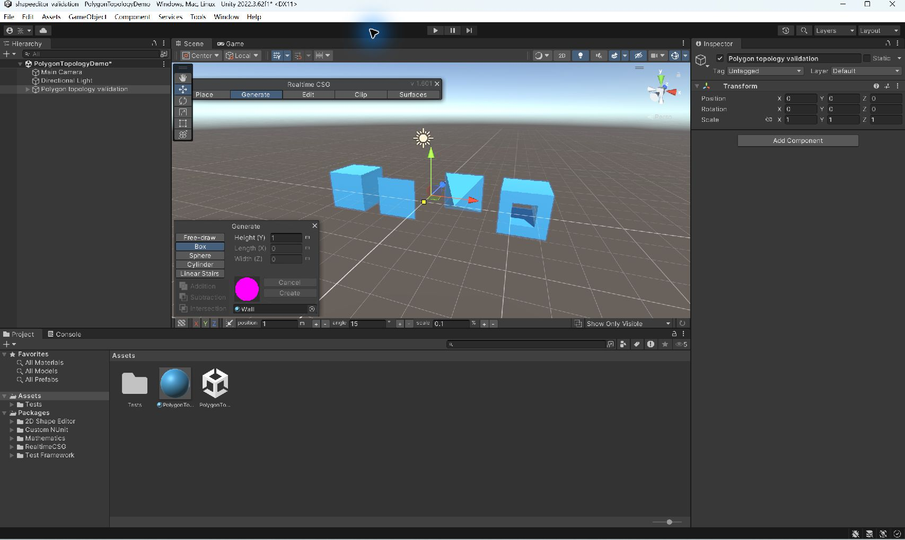

# RealtimeCSG integration tests

These are Unity EditMode tests. They require the real RealtimeCSG package and
native Windows x64 or macOS plugin. A standalone C# compilation with Unity stubs
is not sufficient evidence.

1. Create an empty Unity 2022.3.62f1 project.
2. Add this checkout and `LogicalError/realtime-CSG-for-unity` through Package
   Manager. For the initial validation environment, the RealtimeCSG checkout is
   pinned at `8ea1d81e917c538d8f4563327c2c657b50a355f0`.
3. Install Unity Test Framework 1.1.33 and copy `Editor/` from this folder to
   the project's `Assets/Tests/Editor`.
4. Run the EditMode suite, or invoke the Editor with `-batchmode -runTests
   -testPlatform EditMode -projectPath <project> -testResults <results.xml>
   -logFile <editor.log>`.

The tests use ShapeEditor's own scaled-extrusion generator for cubes and
pyramids. They check half-edge reciprocity, input immutability, parent transforms,
materials, subtraction, and rejection of open/non-manifold inputs before any
scene object is created. Interactive scene verification is also required before
calling the integration complete.

Validated on Windows x64 with Unity 2022.3.62f1 and the RealtimeCSG revision
above: **9 tests passed, 0 failed**, 2026-09-15. This includes actual native
model generation with measured cube (8), pyramid (8/3), and subtracted-cube
(7) volumes. The minimal project also needs Unity's built-in UI and UIElements
modules, which RealtimeCSG references.

## Measured creation time

Run `PolygonMeshBenchmark.Run` with Unity's `-executeMethod`. The benchmark
warms both implementations, alternates their order, and reports the median of
seven samples. It measures brush creation including the conversion and parenting;
object destruction and the later native model rebuild are outside the timer.
The original `ToMaterialPlanes` + `CreateBrushFromPlanes` path is the baseline.
These local timings are not a frame-rate or whole-editor performance claim.

| Extruded polygon sides | Direct topology (ms) | Original planes (ms) |
| --- | ---: | ---: |
| 4 | 0.0846 | 0.0942 |
| 16 | 0.2298 | 2.6427 |
| 64 | 0.8883 | 204.8675 |
| 128 | 2.0355 | 2121.9799 |

## Interactive scene check

With the test files copied into the project, run Tools → ShapeEditor Validation
→ Create demo in current scene. This adds a cube, both zero-cap pyramids, and a
cube with a through-hole. All four were inspected in the real Editor after the
native CSG rebuild. The demo's second menu item applies a Standard material.

The pinned RealtimeCSG checkout's default Wall material refers to shader GUID
`933532a4fcc9baf4fa0491de14d08ed7`, absent from that checkout. Its default material
displayed pink in this minimal built-in-renderer project. The scene check uses
an explicitly assigned Standard material; the package's material assets were
not modified. Default-material rendering is therefore an environment limitation,
not evidence of the topology conversion failing.

Sanitized test results and raw benchmark numbers are in `Evidence/`. Original
Editor logs are intentionally excluded because they can contain login tokens.
